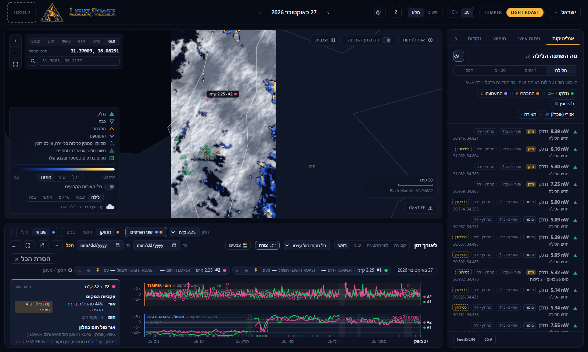
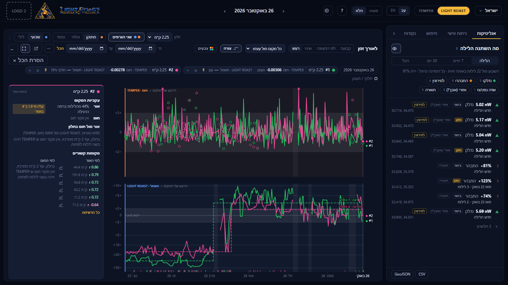
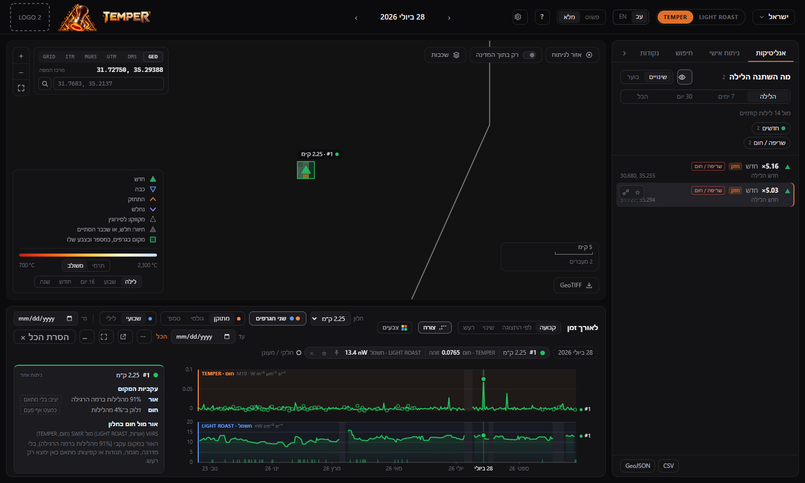
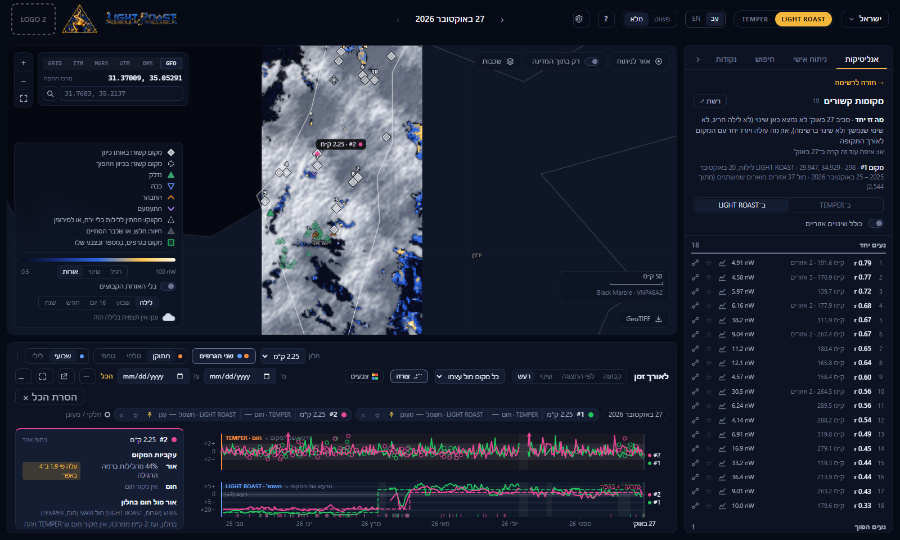
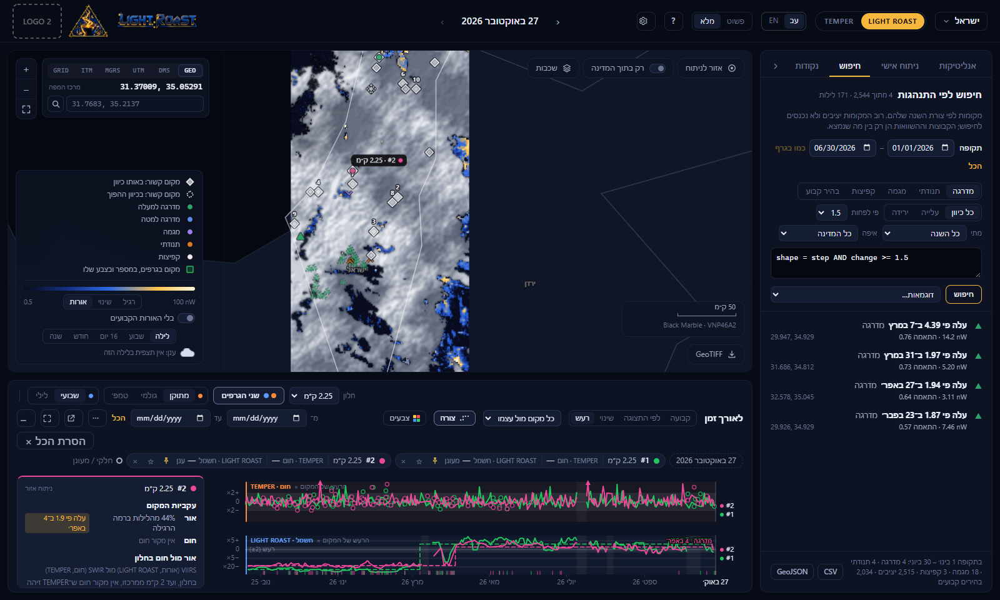
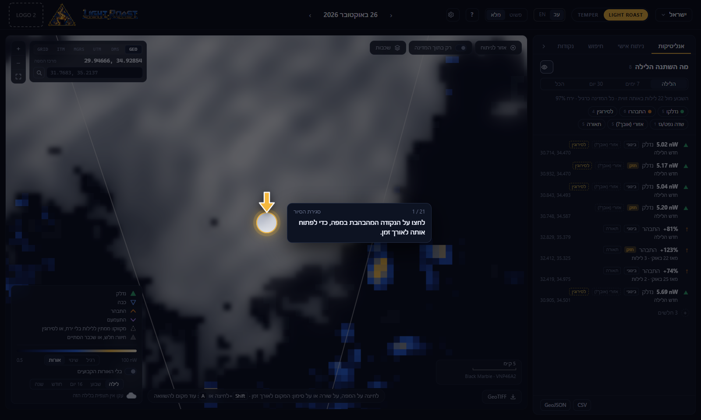
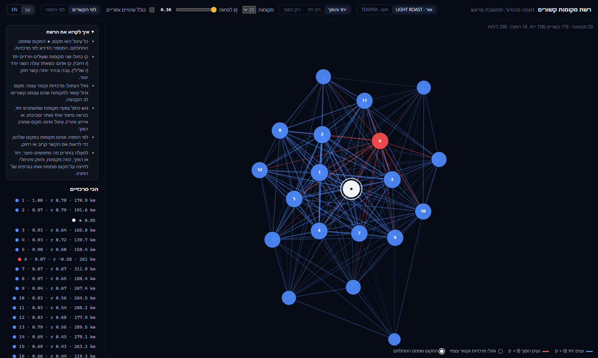
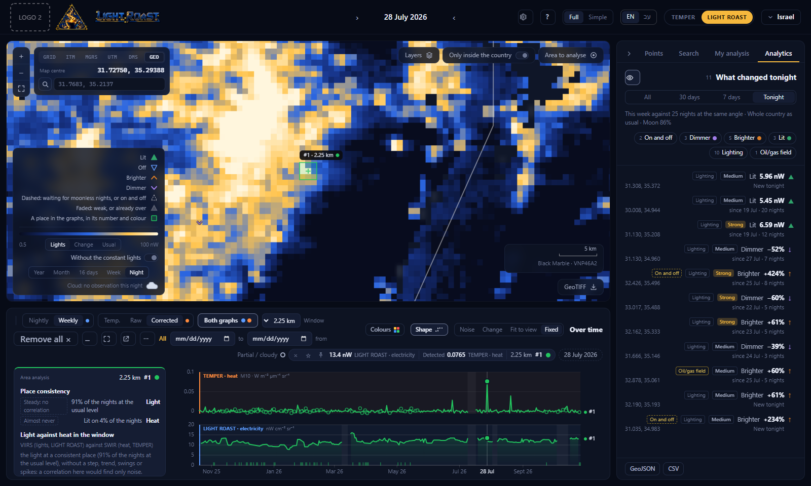
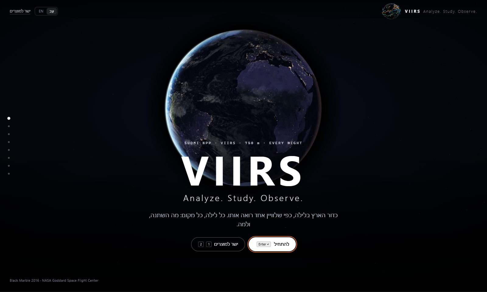

# VIIRS Analysis · TEMPER · LIGHT ROAST

An offline viewer for a year of VIIRS nights over a country: heat at night (fires, gas flares) and changes in night
lights, on one map, one 750 m grid and one timeline, from a single night to how a place behaved all year. A Python
server reads the prepared nights; the page is plain JavaScript without libraries, and nothing touches the internet
while it runs. Hebrew (right to left) and English.



| | |
|---|---|
|  **The Noise scale:** each place against its own night-to-night noise, so a real step stands out |  **TEMPER:** a fire's night, its heat and its light |
|  **Related places:** what moved with a place, ranked |  **Search** by the shape of the year, inside a time frame |
|  **The tour:** learned by clicking what is ringed, on prepared data |  **The network** of related places |
|  **English**, in the same layout |  **The opening**, in NASA's imagery |

### Quick start

Python 3.12 or later (developed on 3.13, on Windows):

```powershell
pip install -r requirements.txt
copy config.example.json config.json    # then set its two data folders
python -B -u server.py                  # opens at http://127.0.0.1:8768
```

The data are not in this repository (hundreds of GB): each country's prepared VIIRS nights, in the folders described
under **Data**. The cache, the saved areas, the tour's lab files and the standalone build are made on the computer that
runs the viewer, and are not tracked either.

Two products on one workspace, switched in the top bar (**TEMPER | LIGHT ROAST**):
- **TEMPER:** fires and gas flares from VIIRS SWIR (M10/M11), with M15/M16 for ground temperature and clouds.
  Orange theme.
- **LIGHT ROAST:** change in night lights from NASA Black Marble (VNP46A2, DNB): no list of bright spots, only what
  changed. Navy and gold theme.

Both share the country, the 750 m grid, the map view, the layers, the places and the night. It runs on one computer
and uses no internet: no remote maps, fonts, CDNs or online APIs. The background map is a bundled file.

How the rules work (thresholds, models, the checks that set them) is in **METHODS.md**. This file is how to use it.

## Starting it

- **The standalone folder:** double-click **VIIRS_ANALYZER.exe**. Nothing to install; see **The standalone folder** below.
- **On this computer:** double-click **Start TEMPER.bat**, or from a terminal:

  ```powershell
  python -B -u server.py
  ```

  `--root <folder>` sets and saves the data root, `--data <country folder>` opens that country at start, `--port`
  another port (default 8768). Ctrl+C stops it. The .bat starts it hidden; closing the browser leaves it running for
  the next visit.

It opens as an app window (Edge or Chrome without tabs or address bar), else in the default browser at
**http://127.0.0.1:8768**.

The opening, **VIIRS · Analyze. Study. Observe.** (`static/intro.js` and the top of `static/index.html`), is an
experience in eight full-screen scenes over a field of stars, one at a time, not a page to scroll. **Enter** goes on
(also Space, ← ↓ PageDown, one turn of the wheel, a swipe up, the button at the bottom); **Shift+Enter** (→ ↑ PageUp)
goes back; the dots on the side jump. Going on, the scene leaving grows past you and blurs away while the next comes
in from the distance and the stars streak by; inside a scene its parts arrive one after another. The scenes, in
NASA's own imagery: the Earth at night turning among the stars (Black Marble 2016), the satellite (Suomi NPP: its
orbit drawn around the globe with the satellite riding it, the numbers counting up), the sensor (a passive radiometer;
Planck's law drawn live, the source's temperature sweeping up from the ground to a gas flare, then a slider, the VIIRS
bands as windows on it, and how much brighter a flame is than the ground in M10 and in M15), the Day/Night Band by full
moon and new moon (the line sweeps across once, then drag it), the region at night slowly closing in, the countries on
this computer lighting up one after another, three things it reveals (flares, blackouts, where people live), what heat
and light together say a change was, and then the menu: the two products and their nights on this computer. **ישר
למוצרים** (Straight to the products) jumps to the menu; on it Enter chooses (the product used last), and keys **1**
and **2** choose from anywhere; a click or any key skips the ~3 s animation. Nothing moves for reduced motion. The images
and the video are NASA's, stored in `static/media/` (about 26 MB) with their credits shown under them; NASA's logo is
not used (it needs NASA's permission), and the page says the viewer is not a NASA product.

Meanwhile a country opens behind the opening, so the workspace and the tour are ready when it ends: the one the
server has open; the server reopens the country used last when it starts (remembered beside your areas, in
`user_areas/.last_country`) and prepares what the page asks for first (both products' change logs and the behaviour
search's shapes); else Israel, else the first with nights. The country's name in the top bar switches country.
After the opening the viewer asks whether to take the tour (see **The tour, by doing**). Straight to work, or when
the tour ends, the country picker opens, so work starts on a country you choose, not where the tour left off; with
"don't ask again", the picker opens right after the opening. Choosing the country already open just closes the picker
(nothing reloads).

## The screen

The interface is in Hebrew or in English (**עב | EN** in the top bar and on the opening; remembered). Switching
changes only the words: the layout stays right to left in both, so nothing moves sides; English lines read left to
right inside their own boxes. Numbers, coordinates and units stay left to right.
- **Top bar:** the country (click to switch), TEMPER | LIGHT ROAST, **עב | EN**, **פשוט | מלא** (Simple | Full),
  **?** (the live tour: ← → or Enter step, Esc closes), **⚙** (settings); in the middle the night (with ‹ ›).
- **Side panel** (right), three tabs: **אנליטיקות** (what changed), **ניתוח אישי** (your areas), **חיפוש** (search
  by behaviour). **›** folds it to a strip.
- **The map** (centre): where. In its corner by the zoom buttons, the coordinates and their search; at the top,
  **◎ אזור לניתוח** (an area to work inside); in the bottom-right corner, **GeoTIFF** (the night as a file).
- **The place** (under the map): how up to four places behaved over time, and the area card.

A row in the list, a mark on the map and a click anywhere on the map all do the same thing: show that place over time.

## Using it

1. **Country and night.** A country is open when the opening ends (see above). The country's name in the top bar
   lists every country under the data root with its outline and nights; click one to switch.
   - A country opens on its latest night. ← is the next night and → the previous one (right to left); with the
     pointer over the night, the wheel steps one night a notch.
   - Choosing the country again also loads newly arrived nights. While nights are being prepared in the background,
     a pill beside the night says **מכין …**.
2. **אנליטיקות: what changed.** It follows the shown night.
   - **הלילה:** what was found on the shown night, each row with that night's numbers and since when it has been
     seen. **7 ימים / 30 יום / הכל:** each change once over that period, from the event log.
   - **Chips:** one per kind (TEMPER חדשים, כבו, התחזקו, נחלשו; LIGHT ROAST נדלקו, כבו, התבהרו, התעמעמו) and per
     cause (להבה, שריפה / חום, שדה נפט/גז, הפסקה אזורית, אזורי, תאורה). Click to hide or show.
   - **A row:** the number that matters, the kind, the cause and how significant it is (weak changes are folded).
     Click: zoom to it and show it over time, its nights shaded in the graph. Shift+click: add it beside the others.
     Hover: **☆** keeps it in your personal analysis; **≈** related places (step 5).
   - **The eye** beside the title takes the list's marks off the map and back. **CSV / GeoJSON** export the rows.
   - **TEMPER, בוער:** the switch beside the title lists tonight's hot spots: measured tonight (a source temperature),
     **מוכר** (a known flare too faint tonight), and under **+** the unconfirmed rest.
3. **The map.**
   - **Hover:** the pixel under the pointer, at the bottom (TEMPER: its source temperature or noise level, both bands;
     LIGHT ROAST: tonight's light and the week against the usual).
   - **Click:** that place over time (a square of the size in the place's toolbar, default 15 km). **Shift+click** adds
     a place; **right-click:** copy the coordinates, add a place, or related places.
   - **רק בתוך המדינה** shows only what is inside the country (and your polygons). **שכבות:** the basemap, TEMPER's
     steady flare sites, the outline, your polygons (import a GeoJSON, or draw: click the corners, Enter to finish).
   - **Legend:** TEMPER **משולב** or **תרמי** (M10/M11 with **⚙ → ערוצים גולמיים**); LIGHT ROAST **אורות**,
     **שינוי** or **רגיל**. Scroll to zoom, drag to pan, **F** fits the country.
   - **בלי האורות הקבועים** (Without the constant lights; LIGHT ROAST, in the legend, lights view): what is lit on
     almost every clear night of the search's time frame (all the nights without one) dims to a trace, so what is not
     always there stands out: new lights, lights that come and go, fires, boats. A constant place that is ×2 off its
     usual level tonight stays lit, so a blackout in a city shows. The readout says whether the pixel under the
     pointer is constant, and its usual level. Worked out once per frame (Israel ~14 s for the year, Saudi Arabia
     ~40 s for three months), kept by month after.
4. **The place.** The panel under the map opens with the first place.
   - **Up to four places,** each one colour everywhere and numbered by it (#1 orange, #2 blue, #3 green, #4 magenta).
     A plain click replaces the place shown last; Shift+click keeps the others. **הסרת הכל ×** removes them all
     (your saved areas stay saved).
   - **Both graphs:** TEMPER above LIGHT ROAST on one time axis, each on its own scale, each with its metric beside it
     in the toolbar (TEMPER **מתוקן / גולמי / טמפ׳**, LIGHT ROAST **שבועי / לילי**).
   - **Reading:** hover the graph for a night's values in each place's chip; hover a chip or a #n to show only that
     place, click to keep it so. Hollow markers are unreliable nights (mostly cloud), ticks at the bottom are clouds,
     shaded stretches have no data.
   - **By mouse:** the wheel zooms time around the pointer, Shift+wheel zooms the values, drag pans, double-click
     shows everything. The wheel over **מ־ / עד** moves those dates. A click opens that night.
   - **⋯:** a fixed scale (Min/Max), **התאמה** back to automatic, **ייצוא CSV**.
   - **Size:** drag the panel's top edge; **⤢** the whole stage, **–** minimize to the row of values, **↗** a window of
     its own (the graphs leave this page until it closes or **החזרה לכאן**).
   - **The area card,** beside the graph: how consistent the place is (light and heat), light against heat inside it,
     and its related places by light and by heat. A steady place says so instead of listing noise.
5. **Related places (≈).** One question: what is related to this place? The place itself decides the answer:
   - **One night stood out** (a fire, a flash, a one-night outage) around the night asked about: **where else the same
     happened that night**.
   - **A lasting change** (a step that stayed): **where else the same change happened then**.
   - **Neither:** if the place varies, **what moves with it** over the graph's period; if it is steady, why there is
     nothing to relate.
   
   The line at the top says which question was answered and why; the link under it asks the other one. The results
   (in the list's place; **→ חזרה לרשימה** goes back) come in two lists, the same way and the opposite way, the
   surprising first, with **how unusual** this was nearby and country-wide. **ב־TEMPER / ב־LIGHT ROAST** chooses the
   product searched. A result's graph icon shows both places side by side.
6. **חיפוש: search by behaviour.** Find places by the shape of their year: **מדרגה** (a change that stayed),
   **תנודתי** (on and off), **מגמה**, **קפיצות**. The buttons write an SQL-like line you can edit, for example
   `shape = step AND direction = down AND change >= 2 AND when BETWEEN 2026-09-01 AND 2026-10-24`; the examples menu
   holds more. **Groups** among the results: steps on the same days in one area, swings that move together. A result
   opens like a change's row.
7. **ניתוח אישי: your areas,** under names of your own.
   - **Adding:** ☆ on any row (kept at once, named after what it is), ☆ on a place's chip, **☆ שמירת המקום**, or
     **ציור אזור** (a polygon). Type a name and press Enter.
   - **Using:** click an area to open it in the graphs beside the others; click again to hide it (it stays loaded).
     Its row gives its numbers for the shown night and its consistency. Hover: rename ✎, related ≈, delete ×.
   - **For all:** **הסתרת הכל מהגרפים**, **מחיקת הכל** (a second click confirms), **GeoJSON** export.
   - **Where they are kept:** `user_areas/<country>.json` beside server.py (or `TEMPER_USER_AREAS`), the same in every
     browser on the computer.
   - **Safe saving:** the viewer saves a country's areas only after they have loaded for that country, and says so
     instead of saving over them; the server refuses a save for any country but the open one, and keeps the last 30
     versions in `user_areas/history/`. To undo a bad save, stop the viewer and copy a version over the file.
8. **⚙ Settings,** for experts: average a place only inside the country and your polygons; the change marks on the
   map; TEMPER's comparison window (7–60 nights) and raw bands; LIGHT ROAST's baseline and method. Keys: ← → night,
   F the whole map, Shift+click another place, Esc cancels (drawing, related places, a kept place, a menu).
9. **Coordinates** (the map's corner, by the zoom buttons). The point under the pointer, or the map's centre when the
   pointer is elsewhere, in the system chosen: **GEO** (decimal degrees), **DMS**, **UTM**, **MGRS**, **ITM** (the
   Israeli grid, EPSG:2039, shown around Israel only) or **GRID** (the data's own EPSG:6933 metres, as in the GeoTIFFs).
   Click the number to copy it; right-click → copy uses the same system. The search box takes any of them and works
   out which: `31.77, 35.21`, `31°46′N 35°12′E`, `36R 711737 3518074`, `36RYA1173718074`, `220000, 631000` (two
   large numbers are ITM around Israel, else read in the system chosen). The map flies there and pins the point;
   **פתיחה בגרף** opens it as a place. The maths is `static/js/geo.js`, checked against PROJ: UTM, MGRS and the grid to
   the metre, ITM within 3 m.
10. **Pinned places.** The pin on a place's chip keeps it in the graphs when another place is opened (a plain click
    otherwise replaces the place shown last), without saving it: it lasts until it is unpinned, removed or the page is
    closed. Nothing to fill in: one click pins, another unpins. ☆ saves the place to your areas under a name of yours.
11. **The scale, for small shifts.** Beside **לאורך זמן** (Over time): **קבועה** (Fixed: from 0, or as zoomed with
    Shift+wheel; the default), **לפי התצוגה** (Fit to view: fitted to the values in the period shown, so zooming in on a
    few weeks gives a small shift the whole height; with 30 values or more it spans the 2nd to 98th percentile, a rare
    spike pinned to the edge with an arrowhead), **שינוי** (Change: each place against its own median in the period
    shown, in percent for radiances, as a difference for TEMPER's corrected mean and the temperature), **רעש** (Noise:
    each place against its usual level, in units of its own night-to-night noise; the noise band, ±2, is squeezed into
    a grey strip and everything beyond it gets the height, one step for each doubling, so ordinary jitter stays flat
    and a shift stands out, a dark place and a bright one alike). While the graph is zoomed in time on the fixed
    scale, **לפי התצוגה** is highlighted.
    - **Against one place.** In Change and Noise, with two places or more, **כל מקום מול עצמו** (Each against itself)
      can be set to **הכל מול #n** (All against #n): every place is then drawn against #n night by night (light:
      their ratio; heat: their difference), so what moves both together (haze, the moon, a regional dip) cancels out
      and only what the place did differently remains; #n itself lies flat on 0. Useful with a nearby quiet place as
      the reference.
12. **The night as a GeoTIFF** (**GeoTIFF**, the map's bottom-right corner). The night's mosaic over the rectangle around the country, as the
    viewer reads it: TEMPER's passes joined (per pixel the smallest view zenith) or LIGHT ROAST's Black Marble tiles
    averaged to the grid; not the raw pass files. Choose the product, the night, the projection (the data's EPSG:6933
    750 m grid as it is, or latitude/longitude by nearest neighbour) and the layers: TEMPER M10 and M11 radiance, M15
    and M16 brightness temperature (K), the view zenith (degrees) and the cloud test (the M15 drop, K); LIGHT ROAST the
    lights (nW cm⁻² sr⁻¹) and the cloudy share. float32, NaN where there is no data, each band named, deflate-compressed.
    Server: `GET /api/export?product=&date=&crs=native|wgs84&bands=&days=` (and `clip=`, `area=`: item 21).
13. **For a first-time user: Simple | Full.** Simple (the default until changed) hides what an expert tunes: the graph's
    metric, window size, period fields and ⋯ menu, the search's query line, the related places' regional switch.
    Everything works the same, and Full shows them all. In Simple, the empty map offers where to start (the night's
    standout change, a place by coordinates, the tour), and an open place offers its next steps: where else it
    happened, pin it in the graph, save it, bring out small shifts (while zoomed), both products together, the night as
    a GeoTIFF.
14. **Hebrew | English.** `static/i18n.js` translates what the page shows from one dictionary (`static/i18n-en.js`,
    Hebrew → English): text and tooltips as they appear, canvas text, dates (the browser's own month names), and the
    server's messages. The layout does not flip; each English line reads left to right in place. The code keeps
    writing Hebrew. A string missing from the
    dictionary shows in Hebrew; your own names and notes are not translated.
15. **A: add to the graphs.** With the pointer on the map, on a mark or on a row of a list, **A** (any keyboard
    language) adds that place beside the ones open, as Shift+click does.
16. **The shape on the graph.** **צורה** (Shape, beside the scale buttons) draws, dashed in the place's colour, the
    shape found for it: from the behaviour search (the shape it was found by), else from the area analysis over the
    graph's period. A step: its level before and after its night; a trend: its straight line; swinging: its low and
    high levels; spikes: the baseline, the spikes ringed. Fitted to the values as drawn (any scale mode).
17. **The night, or a period** (the legend's **לילה · שבוע · 16 יום · חודש · שנה**: Night · Week · 16 days · Month ·
    Year). A period is the calendar block holding the shown night: its week (Monday to Sunday), its 16-day cycle (one
    orbit cycle, every view angle once; blocks of 16 days from 2 Jan 2012), its month or its year. Every night of the
    block shows the same composite, so stepping through the nights of a month changes nothing on the map; only leaving
    the month (or the week, cycle or year) shows another. The map's title names the block (e.g. **הרכב · פברואר 2026 ·
    26 לילות**). TEMPER's combined view: per pixel its strongest night, coloured by that night's temperature; LIGHT
    ROAST's lights: the median of each pixel's clear nights. The readout gives the period's numbers (TEMPER: the
    strongest night, on how many nights it was clearly hot; LIGHT ROAST: the median and the clear nights). The GeoTIFF
    download takes the same periods (see METHODS.md).
    - **Ready before you ask.** The night you look at gets all its periods, of both products, built in the background
      a couple of seconds after it is shown (and the latest night when a country opens), so choosing a period is
      usually instant; then every finished calendar month of the record is built once as a TEMPER month block.
    - **Months saved once.** A TEMPER period is put together from those month blocks (the months it covers whole)
      plus the nights at its two ends, exactly as night by night: a year of Saudi Arabia in ~15 s instead of ~2
      minutes, of Israel in 0.9 s instead of 4.9 s. Blocks are kept compressed in the country's cache (`blocks/`, ~29
      MB a month for Saudi Arabia); the periods themselves, the 8 latest per product. While one is still being built
      the map shows how far it got.
18. **Colours.** **צבעים** (Colours) in the graph's header: eight palettes for all places, each shown as its swatches
    (default, jewel, rainbow, soft, berry, pastel, neon, high contrast). None is orange or blue: orange is TEMPER's
    (heat, **חום**) and blue LIGHT ROAST's (electricity, **חשמל**), as the products are named on the graphs, the chips
    and the menu. Every palette is checked for colour-blind separation on the dark surface (METHODS.md). A place's own
    colour: click the dot on its chip for 22 swatches (reds, pinks, purples, yellows, greens, white, grey), or **צבע
    אחר…** (Another colour…) for any colour from the picker; one near orange or blue is allowed, with a word that it
    looks like a product's. The colour follows the place on the map, its chip and both graphs; kept on this computer.
19. **The map's symbology,** in the legend on the left: only the marks shown now (the changes' kinds, dashed and faded
    ones, hot spots, related places, search results, flare sites, places, a coordinate pin), drawn as on the map.
20. **The tour, by doing.** After the opening (TEMPER or LIGHT ROAST chosen) the viewer asks: **לסיור** (Take the
    tour) or **ישר לעבודה** (Straight to work); **לא לשאול שוב** (Don't ask again) skips the question from then on, and
    **?** in the top bar always opens the tour. Each of its 21 steps is done, then read:
    - **Do:** one control is ringed, with an arrow and a line saying what to click and why; the rest of the screen dims
      and takes no clicks (a click elsewhere says "not there"; after two, **הראו לי**, Show me, does the step). The
      click does what it does in the viewer, at once, from data worked out ahead.
    - **Read:** the tour stops on what the click showed. Numbered marks sit on its parts (the chip and its buttons,
      each graph's axis, the shaded nights, the dashed shape, the list's rows and columns, the search's fields...) and
      a card says what each number is, what the data show there, and how to do it on your own; **הבנתי** (Got it) or
      Enter goes on. What a step showed stays until the next step is done.

    About ten minutes; **סגירת הסיור** or Esc closes it.
    - **On a real place first.** For Saudi Arabia and Israel, one place chosen from the data (`static/story.json`; how
      they were chosen: METHODS.md): click it on the map (it opens over time in both graphs); click the nights in the
      graph where the line jumps (its change, shaded); click the heat graph and the light graph (what each shows
      there); **שינוי** on the scale; pin it; right-click it and choose **מקומות קשורים** (the place moving with it opens
      as #2); the **חיפוש** tab and the step (the places that changed once and stayed). Saudi Arabia: a desert work
      site in the Eastern Province that lit up and flared for six weeks, then went dark on 10 Feb 2026, a place 11.5
      km south dropping the same night. Israel: a dark place in the southern Negev whose light rose about sevenfold in
      early March 2026 and stayed, with no heat. Without a story (Iran, Yemen): the strongest change, a second place by
      Shift+click, the scale, pinning, related places and the search.
    - **Then the tools, each used once:** **16 יום** (the period's composite), **אזור לניתוח** and **✕** back, the
      **ניתוח אישי** and **נקודות** tabs (the tour's places as a point layer; yours come back after), **רשת ↗** (the
      network window, with **איך לקרוא את הרשת**), **↗** (the graphs in their own window, with **איך לקרוא**) and
      **החזרה לכאן**, the coordinates search, **GeoTIFF**, and **?**.
    - **A lab, not a live demo.** Every place, change, related answer, search, composite, network and point layer the
      tour shows is worked out ahead and kept in one file per country (`static/lab/<country>.json`, 2-4 MB), so each
      click answers at once and nothing is computed while you learn. `python server.py --data <country folder>
      --make-lab` writes the shipped file again.
    - **A sandbox.** New data do not touch the tour: it opens on its lab's own night and shows what the lab holds,
      whatever nights have arrived since (a lab is kept for its country and its story; it is made again only for a
      country without one, or when its story changes). While the question or the tour is open the server's background
      work waits (no night is prepared, nothing is built ahead or made again), so nothing loads behind it; when it ends
      the background starts and the viewer moves to the latest night. A hold the page never lets go lapses after 15
      minutes.
    - What the tour set up only to show it (the composite, the demo area, the related panel, the point layer, the
      windows, the coordinate pin) goes back after the next step. The tour taken at the opening ends on the country
      picker, with what it opened cleared, so work starts on a country you choose.
21. **Working inside an area.** **◎ אזור לניתוח** (Area to analyse, on the map): click each corner of a polygon,
    Enter, and give it a name (it is saved in your personal analysis). From then on everything is inside it: the map
    shows the night, or the period's composite, only there and fits to it; the changes and hot spots are the ones
    inside it, with their counts (the chips count only them); the behaviour search and the related places look only
    there; and the GeoTIFF is cropped to its rectangle with NaN outside it (its name in the file's tags and file name).
    The area itself opens in the graphs with its area analysis. A bar over the map names it, its area in km² and its
    counts (**התאמה** fits the map to it again, **GeoTIFF** downloads it). **✕** or Esc goes back to the whole country.
    Any saved area works the same way: **◎** on its row. The area worked in is remembered per country.
    A polygon drawn in the personal analysis (**ציור אזור**) is only saved and named: under its name, **ניתוח כל
    האזור** (Analyse the whole area, off unless ticked) works inside it and opens it in the graphs as soon as the name
    is confirmed; otherwise ◎ on its row does it whenever wanted.

22. **A layer of points** (the side panel's **נקודות** tab). **ייבוא נקודות** (Import points) takes a Shapefile (a
    .zip, or the .shp with its .dbf and .prj, and .cpg for the names' encoding), GeoJSON, or a CSV with lat and lon
    columns. Each point gets its year: its two nightly series over a small window around it (0.75, 2.25 or 3.75 km),
    drawn small in its row (light in blue; heat in orange, with a tick on each night it burned, only where it burned
    on 2+ nights), and the shape of its year in light and in heat (step, trend, swinging, spikes, stable; dark; no
    heat source), as the area analysis finds it. All the points are read together, night by night: about 2 s for 100
    points, 6 s for 500 (Israel). Chips filter by the light's shape; sort by the file, the largest change in light,
    the most nights with heat, or shape; a click opens the point in the graphs (Shift adds it); **CSV** exports each
    point's shapes. On the map the points are coloured by their light's shape, named when the tab is open and the map
    close. Kept per country on this computer.
23. **Importing files.** **ייבוא קובץ** (Import a file, under **שכבות**) and **ייבוא נקודות** read the same files: the
    polygons go to the map's layers (for display, clipping and sampling), the points to the point layer, lines are
    left out (counted). Any projection with a .prj (the Israeli grid, UTM, ...) is put on the grid; without a .prj,
    WGS84 when the coordinates fit in degrees. Up to 60 MB.
24. **The network of related places.** **רשת ↗** (Network) in related places opens a tab with the place and the places
    related to it, every pair among them correlated the same way: edges blue where two places move together, red
    where they move oppositely (wider and stronger with |r|), node size by eigenvector centrality (a place is central
    when it moves with places that are themselves central), the place itself ringed. What to look for: the product,
    together / opposite / both, how many places (15–60), the least |r|, with or without regional changes, and the
    layout (by the links, or by the map). The 20 most central are listed; a click on a node or a row opens that place
    in the viewer's graphs.

25. **A time frame for the search.** **תקופה** (Period) at the top of the **חיפוש** tab: from and to (**כמו בגרף**,
    As in the graph, takes the graph's; **הכל**, All, clears it). The shapes are then worked out on the frame's nights
    only, so a step, trend, swing or spikes inside it are found even when the year as a whole looks different (a step
    then needs a quarter of the frame's nights a side, 6 at least; a frame needs 20 nights). Two more answers:
    **חם קבוע** (Constantly hot, TEMPER): sites burning on at least half of their observed nights in the frame, e.g. 36
    in Saudi Arabia's oil fields (none in Israel, whose busiest site burns on fewer); and **בהיר קבוע** (Constantly
    bright, LIGHT ROAST): places lit on at least 90% of their clear nights. A result opened while a frame is set shows
    the frame in the graph. The same frame drives the map's **בלי האורות הקבועים**.

## Data

The data roots are in `config.json` beside server.py (start from `config.example.json`; without it, the environment's
`TEMPER_DATA_ROOT` and `TEMPER_LR_ROOT`, else `Desktop\ARD\VIIRS_NIGHT_SWIR` and `Desktop\ARD\VIIRS_NIGHT_DNB` in the
user's home folder):

```json
{ "data_root": "D:\\VIIRS\\VIIRS_NIGHT_SWIR",
  "lightroast_root": "D:\\VIIRS\\VIIRS_NIGHT_DNB" }
```

- **TEMPER:** every folder under `data_root` with `raw_data` or `proccessed_data` is a country.
- **LIGHT ROAST:** the folder of the same name under `lightroast_root`; a country without one is TEMPER only.
- **Cache:** each country's prepared nights, in `cache/` (or `TEMPER_CACHE`). The first opening of a country prepares
  them in the background for a few minutes. The cache is keyed by paths relative to the country folders, so moving
  the data keeps it.
- Source data are only read. The server listens on 127.0.0.1 only, and only the viewer's own page may call it.

How countries are outlined (Gaza, the West Bank) and how the nights are prepared: **METHODS.md**.

## The standalone folder

For a Windows computer without Python and without a network. Build it here, copy the folder there:

```powershell
& 'C:\Program Files\Python313\python.exe' build_standalone.py            # dist\TEMPER, then a self-test
& 'C:\Program Files\Python313\python.exe' build_standalone.py --replace  # build again in the same place
```

- **What is in it (~350 MB):** `VIIRS_ANALYZER.exe`; `runtime\` (this Python 3.13 with only the packages the viewer uses:
  NumPy, SciPy, rasterio with GDAL and PROJ, pyproj, Shapely, Pillow); `app\` (the viewer and these documents).
- **How it is made, offline:** the runtime is copied from this computer's Python, the packages are found by importing
  the viewer, and `VIIRS_ANALYZER.exe` is compiled from `launcher\VIIRS_ANALYZER.cs` by the C# compiler that ships with Windows.
  Nothing is downloaded. The self-test runs the folder's Python with this computer's Python hidden, checks every
  module loads from inside the folder, then starts `VIIRS_ANALYZER.exe` and draws a TEMPER and a LIGHT ROAST map.
- **On the other computer:** copy the whole folder somewhere writable (not Program Files), and the data beside it as
  `data\VIIRS_NIGHT_SWIR` and `data\VIIRS_NIGHT_DNB`, or anywhere: the first start asks for the folders and remembers
  them (`VIIRS_ANALYZER.exe --choose-data` asks again). Copy `cache\` into `app\cache\` as well to skip the first preparation.
  `--with-areas` includes this computer's saved areas.
- **Running:** `VIIRS_ANALYZER.exe` opens a small window (close it to stop) and the viewer. Started again while running, it
  only opens the viewer. Windows may warn about an unknown publisher the first time: **More info → Run anyway**.

## For developers

**The hidden math page.** Not in the tour, the help or the screen: three clicks on the product's emblem (top bar,
left of TEMPER or LIGHT ROAST) open what the viewer computes, as a short paper typeset from LaTeX (MathML drawn by
the browser; no library, offline): the grid, noise and significance, detection, source temperature, changes in heat
and in light, the change log and its causes, strong / medium / weak, the shape of the year, related places, the
network, area analysis and composites, each formula numbered (a click copies its LaTeX; **.tex ↓** saves the paper
as a XeLaTeX document). 19 thresholds can be changed there, in a table in their section by their symbol (event
linking and causes, the shapes, the related-places floor, active heat, a composite's hot night), each with its range
and default; **החלה** (Apply) makes again what depends on them (the change log, the shapes, the kept answers, the
tour's lab), and **הכל לברירת המחדל** puts them all back. Changed values are kept in `config.json` (`params`).

**The code:**

| File | What it holds |
|---|---|
| `server.py` | The server, in sections listed at its top: settings, the event log, saved areas, related places, behaviour search, consistency, area analysis, countries, `Dataset` (TEMPER's data), map images, the HTTP routes (`GET_ROUTES`, `POST_ROUTES`), background workers |
| `lightroast.py` | LIGHT ROAST: lights, clouds, blocks, calibration and changes |
| `bands.py`, `evt.py`, `rxmethod.py` | TEMPER's M11/M15/M16 bands; the extreme-value threshold; the RX night-lights method |
| `static/index.html`, `app.css` | The page and its styles (a strict CSP: no inline scripts or styles) |
| `static/js/*.js` | The page's code, classic scripts sharing one scope, loaded in order: `core` (state, helpers), `map`, `geo` (coordinate systems, pure maths), `coords` (the coordinates box), `places` (places, pins, colours, the area card), `list` (אנליטיקות), `related`, `chart` (and its scale modes), `search`, `areas` (ניתוח אישי), `focus` (working inside an area), `export` (the GeoTIFF dialog), `guide` (Simple / Full, where to start, next steps), `main` (start-up). Each says what it holds at its top |
| `static/i18n.js`, `i18n-en.js` | Hebrew / English: the translator (loaded first) and its dictionary. After adding Hebrew text, add its English there |
| `static/help.js`, `intro.js` | The tour, learned by doing (the question after the opening, each control ringed in turn, its answer from the lab) and the opening (VIIRS · Analyze. Study. Observe.) |
| `static/js/points.js`, `math.js`, `focus.js` | The point layer, the hidden math page (LaTeX to MathML, its paper and thresholds), working inside an area |
| `static/network.html`, `js/network.js` | The network of related places, in its own tab |
| `vectors.py` | Reading the user's files: GeoJSON, CSV of points, Shapefiles (no other library) |
| `static/story.json` | The tour's story per country: the place, its change, its partner, its step, and the texts (chosen from the data; METHODS.md) |
| `static/lab/<country>.json` | The tour's lab: every place, change, answer and search it shows, worked out ahead (`server.py --make-lab`, or by the server in the background for a country without one). Made from the data, so not in the repository |
| `static/media/` | NASA imagery for the opening (Black Marble 2016 globe video and stills, Blue Marble 2012, the Persian Gulf by moonlight, Puerto Rico 2017), resized here; credits are on the page |
| `check_rules.py`, `reference/known_cases.json` | The rules scored against places whose truth is known (METHODS.md, **Checking the rules**). The stored changes of the nights before a newly arrived one are rebuilt only for the country open in a viewer: let that country's background work finish before scoring |
| `check_i18n.py` | Lists Hebrew text in the code with no English in `static/i18n-en.js` (exit code = how many) |
| `build_standalone.py`, `launcher/VIIRS_ANALYZER.cs` | The standalone folder |
| `start.ps1`, `Start TEMPER.bat` | Start the server hidden on this computer and open the viewer as an app window |
| `config.example.json` | The data roots, to copy as `config.json` (which also keeps the thresholds changed on the math page) |
| `Containerfile`, `deploy/openshift/` | The container image and its OpenShift deployment |
| `docs/images/` | The screenshots above |

- **Testing:** a test server must set `TEMPER_USER_AREAS` to a folder of its own, so a test never writes the user's
  saved areas.
- **Logos** are in `static/brand/`: VIIRS Analysis's (`viirs-logo.png`, cut from the logo given for it, and
  `viirs-icon.png`, square, the source of `viirs-icon-small.png`, the opening's tab icon, and of `viirs.ico`,
  VIIRS_ANALYZER.exe's icon), TEMPER's and LIGHT ROAST's emblem, wordmark, full logo and tab icon. VIIRS Analysis's
  logo is the opening's; the TEMPER and LIGHT ROAST pages' top bar shows only the product's emblem and wordmark, after
  a slot, `logo-slot-2.svg`, a placeholder for a partner logo (replace it; any width at 56 px high).
- **OpenShift:** `deploy/openshift/README.md`.

## Credits

- **Imagery in the opening** (`static/media/`): NASA (Goddard Space Flight Center, Earth Observatory; Black Marble,
  Suomi NPP / VIIRS), each credited on the page under it. NASA's logo is not used, and the viewer is not a NASA or
  NOAA product.
- **Country outlines** (`static/basemap/`): Natural Earth, public domain.
- **The data it reads:** VIIRS on Suomi NPP (NASA / NOAA), and NASA's Black Marble night lights (VNP46A2).
